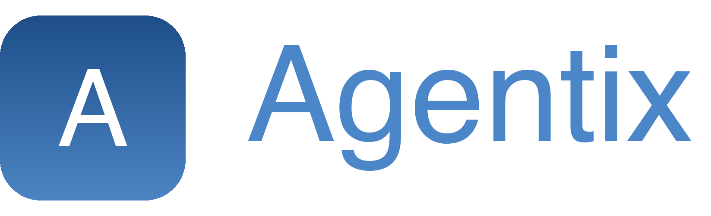
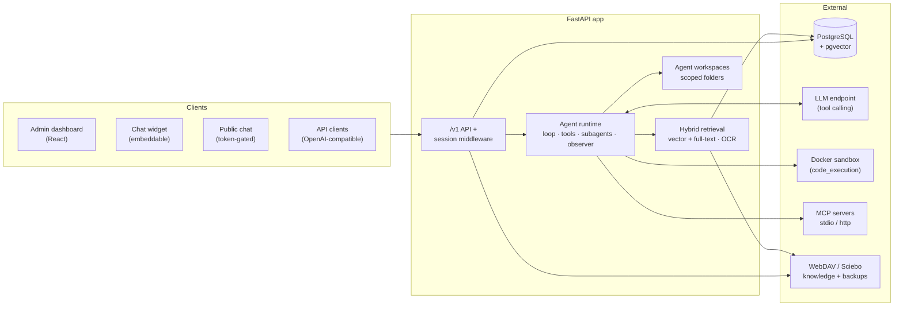
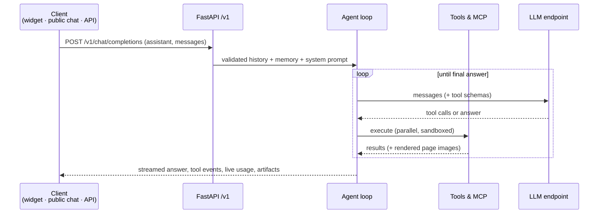

<div align="center">
  
  <h1>Agentix Agent Platform</h1>
  <p><strong>A self-hosted LLM agent platform.</strong><br/>
  <em>OpenAI-compatible API · tool-calling agent runtime · hybrid RAG · automation · full admin UI</em></p>

  [](https://www.python.org/)
  [](https://fastapi.tiangolo.com/)
  [](https://react.dev/)
  [](https://www.postgresql.org/)
  [](https://www.docker.com/)
</div>

---

Agentix turns any OpenAI-compatible LLM endpoint into a **persona-driven agent platform**: assistants with their own models, tools, knowledge collections and workspaces — served through an admin dashboard, an embeddable widget, a token-gated public chat and a drop-in `/v1` API. Self-hosted and designed to be useful anywhere a capable, private agent platform is needed.


## Why Agentix

### Agents that do real work, not just chat

The built-in agent runtime (`docs/agent.md`) runs a full tool-calling loop — no external framework required:

- **Parallel tool calling** in native or JSON mode, with same-target conflict serialization and atomic multi-op edits
- **Subagents** — isolated background clones with their own budgets, wait/status/nudge control and shared workspace
- **Run observer** — a lightweight supervisor that detects stalls, error streaks and budget pressure, then nudges the agent
- **Todo gate** — a run can't finalize with open tasks; the plan has to be finished first
- **Mid-run steering** — users inject messages into a running agent via `POST /v1/chat/runs/{id}/input`
- **Resilience** — stream/run watchdogs, rolling-history compression, content dedup, persistent per-conversation memory

### Workspace, files & artifacts

Each assistant gets a **persistent, scoped workspace** (per conversation / user / assistant) the agent can read, write, edit and share:

- Uploads flow in (`import_upload`), artifacts flow out (`offer` → downloadable cards with previews)
- **Document generator** — real DOCX/PPTX/PDF/XLSX/CSV with themes, charts, tables and drafts
- **Vision pipeline** — PDF/Office pages render to images the model actually sees (LibreOffice + PyMuPDF, LRU-cached)
- **Sandboxed `code_execution`** — isolated Docker containers with TTL, resource limits and the workspace mounted in

### Knowledge & RAG

- **Hybrid retrieval** — vector + full-text search fused with RRF, plus structured `action='read'` document access
- **Ingestion** — PDF/Office/text with OCR, per-file indexing status, full versioning
- **Sources** — WebDAV/Sciebo sync (ETag change detection, encrypted credentials) and OKF graph export

### Automation

- **Triggers** — cron/interval schedules that run assistants on autopilot with run history
- **Agent chains** — a visual node editor for multi-step flows (parallel branches, joins, templates)

### Every surface covered

| Surface | What you get |
|---|---|
| **Admin dashboard** | Full React UI — configuration, metrics, archives, backups — in English & German, light & dark |
| **Chat (admin + public)** | Streaming answers, reasoning & tool-call panels, artifacts, **live token counter with mini charts**, TTS/STT, emotion display |
| **Embeddable widget** | Drop-in chat bubble for any website — configurable in the UI |
| **`/v1` API** | OpenAI-compatible `chat/completions` + SSE streaming, run status/stream/cancel/input, file & artifact downloads |

### Operational by default

- **Metrics that matter** — per-page analytics (usage, models, latency, blocked) plus per-message metrics popovers in chat
- **Encrypted backups** — PostgreSQL dumps to WebDAV/Sciebo with a mandatory key and **verified restore**
- **Access control** — RBAC roles & permissions, scoped API keys, token-gated public chat, user management UI
- **Conversation archive** — searchable history with detail views, exports and per-conversation memory inspector

### Extensible where it counts

- **25+ built-in tools** — web/academic search, Wikipedia full-text read, e-mail, calendar, SSH, RSS, code execution and more
- **Custom tools** — define your own in JS or Python with JSON-schema validation
- **MCP servers** — stdio and HTTP, behind allow/deny filters

## Platform at a glance



Deep dives: [architecture](docs/architecture.md) · [agent runtime](docs/agent.md) · [tools](docs/tools.md)

## How a request flows



## Quick start

| Requirement | Notes |
|---|---|
| Python 3.11 | App runtime |
| PostgreSQL 14+ **with pgvector** | External — not shipped in compose |
| Node.js 20+ | Only for rebuilding dashboard/widget |
| Docker daemon *(optional)* | `code_execution` sandbox containers |
| LibreOffice *(optional)* | Office previews, `view` on Office docs, PDF export |

```bash
uv sync && source .venv/bin/activate
cp .env.example.minimum .env   # set PG* + LLM_API_* values
python -m app.server
```

Or with Docker:

```bash
cp .env.example.complete .env
docker compose -f docker-compose.example.yml up -d --build
```

Then: dashboard at `/dashboard` · interactive API at `/docs` · health at `/health`. Full guide: [docs/installation.md](docs/installation.md).

> [!NOTE]
> The compose file ships **no database** — point `PG*` at an existing PostgreSQL+pgvector instance.

> [!IMPORTANT]
> Set `BACKUP_ENCRYPTION_KEY` **before** the first backup and store it outside the repo — restores are impossible without it. WebDAV source passwords are Fernet-encrypted via `WEBDAV_ENCRYPTION_KEY`.

> [!WARNING]
> `code_execution` needs Docker socket access (`/var/run/docker.sock`). Without it that tool fails gracefully — everything else still works.

> [!TIP]
> Want an external chat surface? Enable the token-gated **public chat** (`/chat`) or drop the **widget** snippet on any page — both are configured in the dashboard under *Widget & Chat*.

## Security & isolation

- Session-cookie dashboard + **RBAC permissions**, scoped API keys for `/v1/*`, token-gated public chat
- Conversation/user/assistant-scoped workspaces — path containment, symlink & traversal rejection, per-assistant quotas
- Tool execution isolated: `code_execution` in TTL-bounded containers, MCP behind allow/deny filters
- Secrets never leave the API (`password_set` flags); backups encrypted with a mandatory `BACKUP_ENCRYPTION_KEY`
- Full model: [docs/security.md](docs/security.md)

## Documentation

Full documentation lives in **[docs/](docs/index.md)**:

- [Overview](docs/overview.md) · [Installation](docs/installation.md) · [Configuration](docs/configuration.md) · [Deployment](docs/deployment.md)
- [Architecture](docs/architecture.md) · [Agent runtime](docs/agent.md) · [Tools](docs/tools.md)
- [Administration](docs/administration.md) · [Security](docs/security.md) · **[Backup & Recovery](docs/backup-and-recovery.md)**
- [API Reference](docs/api.md) · [Widget](docs/widget.md) · [Development](docs/development.md) · [Troubleshooting](docs/troubleshooting.md) · [Roadmap](docs/roadmap.md)

---

<div align="center">
</div>
