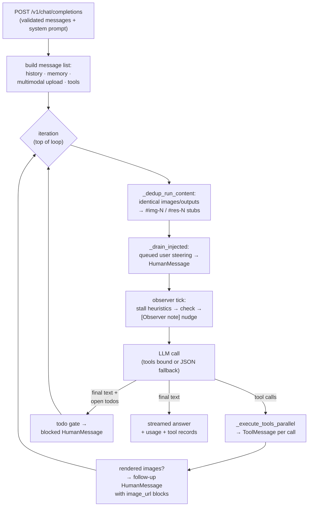
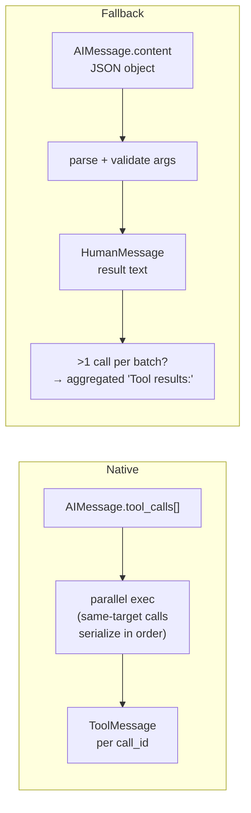
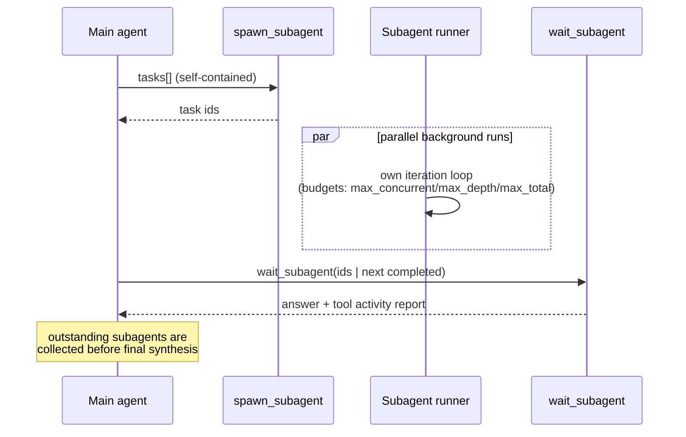
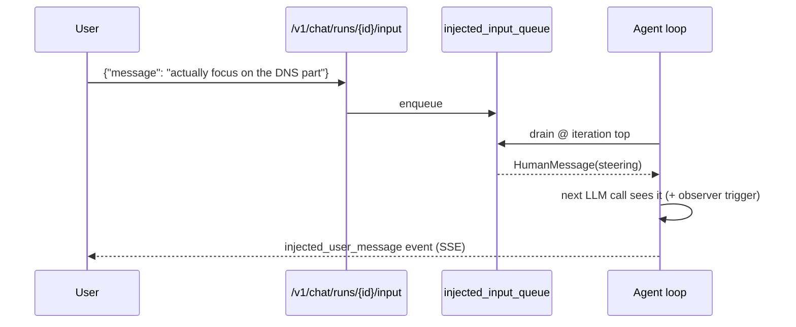
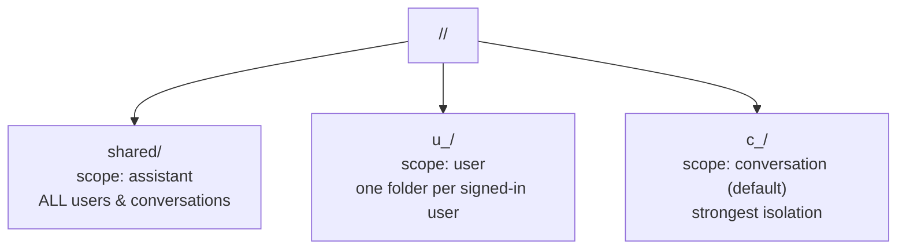
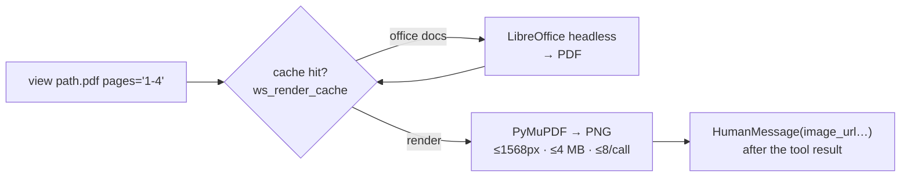
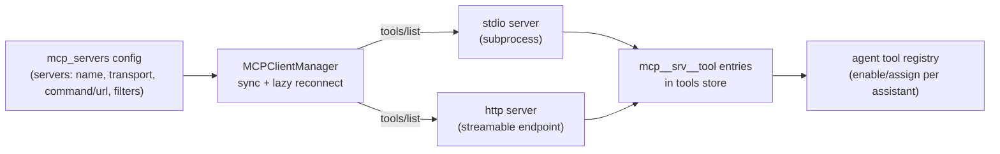

# Agent Runtime

How an agent-enabled assistant turns a chat request into an answer: the iteration loop, tool calling modes, content deduplication, subagents, the run observer, mid-run steering, context management, workspaces, artifacts and MCP integration.

[[_TOC_]]

## Overview

When `agent_enabled: true` is set on an assistant, `/v1/chat/completions` runs a **LangChain-style agent loop** (`agent/tools/runner.py` → `AgentRunner`) instead of a single LLM call. Each iteration calls the model with the current message list plus the assistant's tool schemas; tool calls are executed (in parallel, up to `max_parallel_tool_calls`) and their results feed the next iteration until the model answers directly or a budget (`max_iterations`, `max_tool_calls`) is exhausted.

> [!note]
> Everything below happens **per run**. Subagents run their own `AgentRunner` instance with their own budgets, dedup state and observer — see [Subagents](#subagents).

## Tool-calling modes

The runner supports two wire strategies and picks per provider capability:

| Mode | Condition | Tool result transport |
|---|---|---|
| **Native tool calling** | model/provider supports `tools` schema (auto-detected per provider, overridable) | OpenAI `tool_calls` / `role:"tool"` messages with `tool_call_id` |
| **JSON fallback** | no native support (`supports_native_tool_calls: false` or detection failed) | model emits `{"tool_name": {...args}}` JSON; results ride in `HumanMessage`s (`Tool 'x' result:` / aggregated `Tool results:`) |

Argument normalisation (`agent/tools/validation.py`) coerces types against the JSON schema (e.g. strings → arrays, unknown args → notes appended to the result). Outputs are truncated via `truncate_tool_output` (15,000 chars + continuation footer).

**Same-target serialization.** Within one batch, calls run in parallel — except calls that mutate the same target: a tool can implement `call_conflict_key(args)` returning a hashable key, and batch calls sharing `(tool_name, key)` execute sequentially in call order so each sees the previous call's result. Otherwise parallel read-modify-write cycles lose every write but the last (e.g. two `collection_manager` edits on the same file). Implemented by `collection_manager` (`collection/filename`), `agent_workspace` (`path`), `document_generator` (`draft_id`, else `workspace_path`), and `code_execution` (`job_id` for job ops, `sandbox-exec` for foreground execs — the shared sandbox namespace makes parallel execs unsafe anyway).

`collection_manager` additionally holds a per-file mutex on the shared registry instance: subagents (and concurrent conversations) run as asyncio tasks in the same process, so their create/edit/delete calls on the same file serialize atomically — the second writer re-reads the first's saved state. The lock guarantees atomicity, not intent: an edit planned against an older snapshot still applies to current content (e.g. line numbers may have shifted). Single-process only — multi-worker deployments would need filesystem-level locking. `agent_workspace` uses the same pattern with per-resolved-path locks on every mutating action (`move` locks source+destination in sorted order).

**Multi-op transactions.** For ordered multi-edits prefer one `edits` batch over N separate calls: `collection_manager` and `agent_workspace` accept `edits: [{operation: insert|remove|replace, ...}]`, `document_generator` accepts `edits: [{operation: replace|insert|remove|move, index|from|to, section|slide|sheet}]` on drafts. Ops run sequentially on the evolving state — later ops see earlier results — and persist **atomically**: one failure discards the whole batch (the error names the op index) and a single save happens at the end. Line/item indexes refer to the *current* state, so text anchors (`after_text`, `text_snippet`, `old_text`) or bottom-up ordering are the robust choice.

## Content deduplication (`_dedup_run_content`)

Every iteration resends the full message list. To keep the payload minimal without losing access to earlier content, the runner enforces **exactly-once semantics**:

| Content | Key | Behaviour |
|---|---|---|
| `image_url` blocks | data-URI (bytes) | Latest occurrence keeps the image; earlier ones become `[#img-N — identical image omitted; shown once in the latest image result below]` |
| Tool outputs > 1000 chars | `sha256(stripped text)` | Latest `ToolMessage` / tagged fallback result keeps the output; earlier ones become `[#res-N — identical output omitted; see the latest '<tool>' result below]` |
| Image budget | — | At most **16** unique live images; oldest evicted (tool renders before user uploads) → `[#img-N — omitted to save context; call the tool again]` |

- IDs are **stable per run** (`img-1` stays `img-1`); kept copies are never labelled, so re-viewing a file later re-uses the same id.
- Covers every image source: workspace `view` renders, user uploads (`multimodal_input`), attachment images and client-echoed history images — all live in the same `messages` list.
- Stubs are plain text (< 1000 chars, no `image_url`), so a second pass is a no-op — dedup is idempotent.
- Fallback-mode tool results are tagged internally (`run_tool_result`) so real user text starting with `Tool '` is never deduplicated; `additional_kwargs` tags never reach the wire.

> [!tip]
> If an image was evicted for budget, the stub explicitly tells the model to call `view` again — re-rendering is disk-cached and cheap.

## Subagents

`spawn_subagent` launches an isolated background clone of the assistant: same model and instructions, **no chat history**, parent's tool set minus `subagents.exclude_tools`. Each subagent gets its own `AgentRunner` (own dedup state, todo list, observer if `observer.include_subagents`), resolves the **same workspace folder** as the root run, and reports back via `wait_subagent` (optionally "next completed" instead of "all"). `subagent_status` inspects live progress.

`nudge_subagent(subagent_id, message)` pushes mid-run guidance into a running child: the message lands in the child's own injected-input queue and is delivered as a `[Message from parent agent]` HumanMessage before its next iteration — also waking `wait`/`wait_subagent` inside that child. One-way only (the child cannot reply); works at any nesting depth against directly spawned children. Users can nudge subagents the same way via `…/input` with `subagent_id` (delivered as `[User message]`) or the dashboard's subagent detail view; received nudges show up in the record's `nudges` list.

> [!important]
> Include **all** needed context in each task — subagents see neither the chat history nor earlier subagent output. Workspace writes are shared (same resolved folder); user-visible `offer` artifacts go through the derived conversation id.

## Run observer

An optional lightweight supervisor (`agent/observer.py`) watches the run at iteration boundaries without blocking it:

| Trigger | Condition | Purpose |
|---|---|---|
| `periodic_iterations` / `periodic_seconds` | `every_iterations` (default 4) / `every_seconds` (default 180) cadence | Routine progress check |
| `repeat_tool_calls` | last 3 eligible calls identical (tool + args) | Semantic stall |
| `error_streak` | 3 consecutive failed results | Tool errors |
| `stale_todo` | todo unchanged for `every_iterations` while open tasks remain | Forgotten plan |
| `no_todo` | tools used, no todo — **only from `iteration ≥ every_iterations`** (early iterations are never nagged) | Missing plan |
| `budget_pressure` | ≥ 80 % of iteration/tool budget spent | Wrap up |
| `user_input_injected` | steering arrived | Re-evaluate plan |

A check runs asynchronously, never blocks an iteration, and a failing observer LLM never aborts the run. Results reach the agent as `[Observer note]` messages (budget-capped by `max_checks`/`max_nudges`) and surface in the dashboard as observer events. Config: `observer.enabled`, `assistant`, `every_*`, `max_*`, `check_timeout_seconds`, `include_subagents`, `instructions` — see [Configuration](configuration.md#run-observer).

**Todo gate.** A run cannot finalize while its todo list still has open tasks (`pending`/`in_progress`): when the agent tries to answer with open tasks remaining, the runner appends the answer plus a `[Finalization blocked]` HumanMessage naming the open tasks and iterates again — the agent must finish the work or mark each task `completed`/`skipped` first. After 3 blocked attempts (`MAX_TODO_FINALIZE_REMINDERS`) finalization is forced anyway and leftovers are swept to `skipped` (the dashboard renders skipped tasks red and struck through). The same gate applies to subagent runs; forced endings (`max_iterations`, idle timeout, cancel) always sweep.

## Mid-run steering (message queue)

`POST /v1/chat/runs/{conversation_id}/input` enqueues a user message into the **running** agent's `injected_input_queue` and sets its `input_event`. At the top of every iteration `_drain_injected` appends queued messages as `HumanMessage`s — the agent sees them on its very next LLM call and can change course mid-run. Tools that block mid-iteration race the event: `wait` and `wait_subagent` (including the pre-finalization auto-collect) return early the moment input is queued instead of sleeping out their delay. An optional `subagent_id` routes the message into that child's nudge queue instead.

The same queue carries **system nudges**: when a background `code_execution` task (see below) finishes, the tool enqueues a short `source: "code_execution"` notice telling the agent the task id completed and to collect it via `action='result'` — the full output is never injected automatically. Every injected item carries a `source` (`"user"`/absent for steering, tool name for system nudges); it is forwarded as `injected_source` in the SSE delta so the UI renders task notes as centered system notes instead of user bubbles.

### Background code tasks

`code_execution` with `background: true` runs the Python call asynchronously: it returns a `task-N` id immediately (the sandbox cold-boot happens inside the task, so the tool call itself never blocks) and up to 10 tasks may be registered per conversation. Tasks share the sandbox's single exec lock (one namespace, one stdout capture), so they **execute strictly one at a time** — a second task queues behind the running exec up to the exec cap instead of failing; a foreground `exec` on a busy sandbox waits only ~5s and then fails fast with a "still running" error (collect via `result`/`wait` instead of retrying). Installs take the same lock so pip never writes into a running import. On completion — success, error or cancellation — the agent is auto-nudged (see above) and collects the result via `action='result'` + `job_id='task-N'`; `wait` blocks until done (racing `input_event` like shell-job waits), `kill` cancels the asyncio task, and `jobs` lists tasks alongside shell jobs. Task actions dispatch **before** the sandbox boots, so reading a finished result never requires Docker. Records persist in the per-conversation registry (newest 50 finished kept), so a result stays retrievable even when the run ended first — a nudge queued after the run ends simply surfaces as an `unconsumed_inputs` report.

Run-control endpoints (same auth cascade as `/v1/chat/completions`):

| Endpoint | Purpose |
|---|---|
| `GET /v1/chat/runs/{id}` | Run status + tool activity snapshot |
| `GET /v1/chat/runs/{id}/stream` | SSE stream of the live run (tokens, tool events, injected messages) |
| `POST /v1/chat/runs/{id}/cancel` | Abort the run gracefully |
| `POST /v1/chat/runs/{id}/input` | Queue steering text (see above) |

## Context management

Long runs are bounded by several independent mechanisms:

- **Rolling history** — older turns are summarised by a summary LLM when the context window fills (`ROLLING_HISTORY_*`); recent turns always stay verbatim.
- **Compression** — old `ToolMessage` payloads are compacted; emergency truncation (`_hard_truncate`) is the last resort.
- **Token accounting** — `stringify_message_content` skips `image_url` parts, so base64 never inflates text token budgets.
- **Content dedup** — see [above](#content-deduplication-_dedup_run_content): identical payloads physically leave the context.
- **Stream watchdog** — two layers: `STREAM_IDLE_TIMEOUT_SECONDS` aborts an LLM stream that stalls mid-flight, and `RUN_IDLE_TIMEOUT_SECONDS` (default 900s) aborts a run that produces no *real* stream items for that long — tool keepalives are flagged and don't count, so a stuck tool call dies while healthy long jobs (e.g. code_execution) fit inside the window. The observer detects *semantic* stalls instead.

## Agent workspace

`workspace.enabled: true` gives the assistant a persistent folder the agent manages via the `agent_workspace` tool (`app/agent_workspace.py` + builtin tool). The code-execution sandbox sees the same folder at `/agent_ws`.

### Scopes

> [!warning]
> `scope: assistant` shares one folder across **every** caller — only for trusted single-user setups. `user` scope falls back to per-conversation for anonymous callers; API access to it requires a signed-in identity (401 otherwise).

### Actions

| Action | Purpose |
|---|---|
| `list`, `read`, `write`, `append`, `mkdir`, `delete`, `move`, `edit` | File management inside the resolved scope dir — `edit` applies an ordered `edits` batch atomically; `read` supports `line_numbers` for line-based ops |
| `offer` | Expose a file to the user as a downloadable chat artifact card |
| `list_uploads`, `import_upload` | Pull chat attachments into the workspace (`uploads/<name>`, quota-enforced) |
| `view` *(needs `vision_read`)* | Render PDF/Office/image pages to actual `image_url` blocks the model sees |
| `inspect` | Structural metadata: slide shapes/positions, docx outline, sheet dims, embedded media (`extract_media=true` → `extracted/<name>/`) |

Writes pass through `resolve()` (path containment + symlink rejection) and per-assistant quotas (`max_file_mb`, `max_total_mb`, `max_files`). Subagents inherit the root run's resolved folder.

### Vision pipeline

`AGENT_WORKSPACE_RENDER_CACHE` (default `<agent_workspaces>/../ws_render_cache`, LRU 256 MB/24 h) caches converted PDFs and rendered pages. `inspect` also parses OOXML structure (`python-pptx`/`python-docx`/`openpyxl`) and can extract embedded media (ZIP members capped).

### Read-only API

`api_enabled: true` exposes `GET /chat/assistants/{name}/workspace/files` and `…/workspace/file?path=…` under the assistant's own access rules — see [API Reference](api.md#agent-workspace-api). Revocable anytime; data stays.

## Artifacts

Files the agent produces reach the user as **artifact cards below the assistant's answer** (download + inline preview + export):

- `document_generator` — DOCX/PPTX/PDF/XLSX/CSV with themes, charts, tables and diagrams (xlsx: multi-sheet with native charts; csv: first sheet of the sheets spec). `workspace_path` additionally writes a copy into the agent workspace (relative path, extension forced to `kind`; storable at draft `create`, overridable at `finalize`). Files are attached to the chat by default — `deliver=false` keeps the artifact internal, and `action='publish'` + `filename` attaches an existing artifact later. Reusing the same filename updates the artifact in place (index + preview cache invalidated), so the already-shown card refreshes instead of producing a `name-2.ext` duplicate
- `code_execution` — sandbox outputs marked as artifacts
- `agent_workspace` `offer` — workspace files handed to the user

Delivery: `GET /v1/chat/files/{conversation_id}/{filename}` (+ `/preview`, `/preview/page/{n}`, `/export/{fmt}`); access follows the conversation's bearer semantics.

## MCP integration

`app/mcp_client.py` connects the platform to external **Model Context Protocol** servers. The `mcp_servers` tool entry (dashboard → Tools) holds a server list; `MCPClientManager` discovers remote tools (`tools/list`) over **stdio** or **streamable-HTTP** and materializes them as `mcp__<server>__<tool>` store entries that can be enabled/assigned like builtin tools.

Tool calls route through a dumb `MCPToolProxy` built from the persisted schema — it survives restarts and outages; `call_timeout`, `tool_filter`/`deny` globs bound the surface.

## Memory & planning helpers

| Tool | Purpose |
|---|---|
| `agent_memory` | Persistent scratchpad **per conversation** — survives turns, admin-inspectable |
| `agent_todo` | Run-local todo list; renders into the system context and the dashboard todo panel. Statuses: `pending`, `in_progress`, `completed`, `skipped` (dropped tasks — auto-set at run end for anything left open) |
| `plan_generator` | Structured plan for a goal |
| `wait` | Bounded sleep for polling/retry patterns |
| `assistant_caller` | Call another assistant as a tool |

## Metrics & traces

Every run records per-iteration usage (prompt/completion/reasoning tokens), tool-call records (name, args, output preview, duration) and observer events into the response `metadata`, the metrics pipeline and the dashboard run view — no base64 or file payloads ever land in traces.
