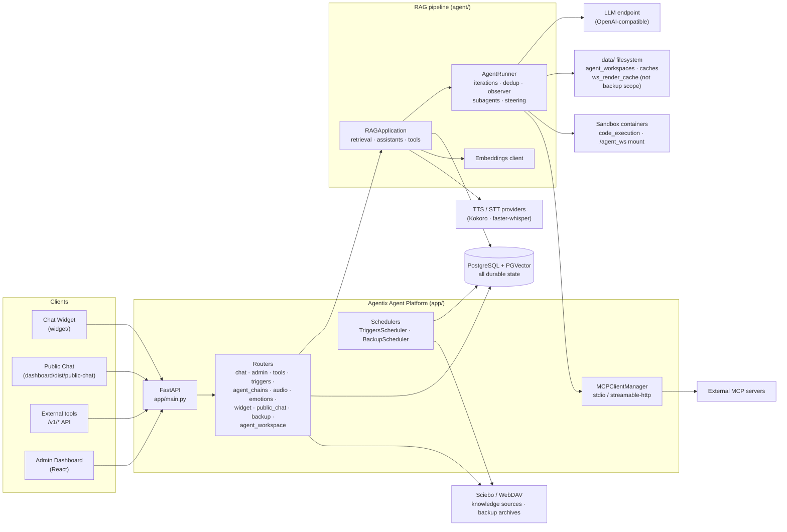
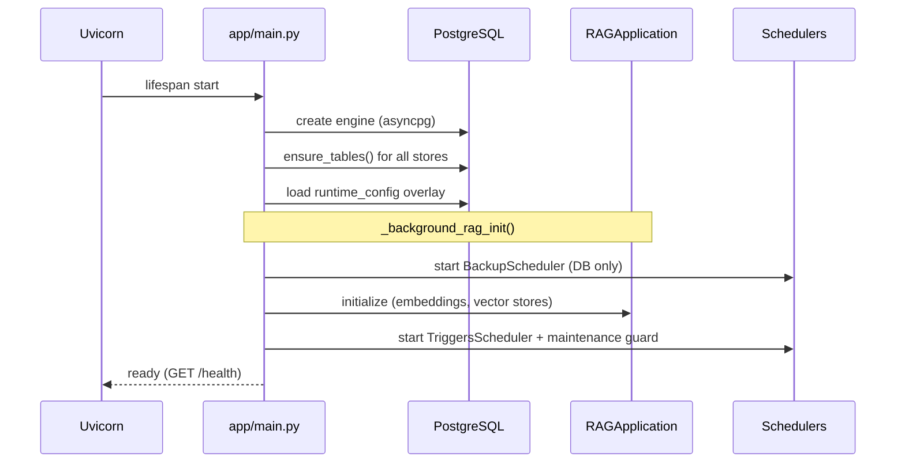
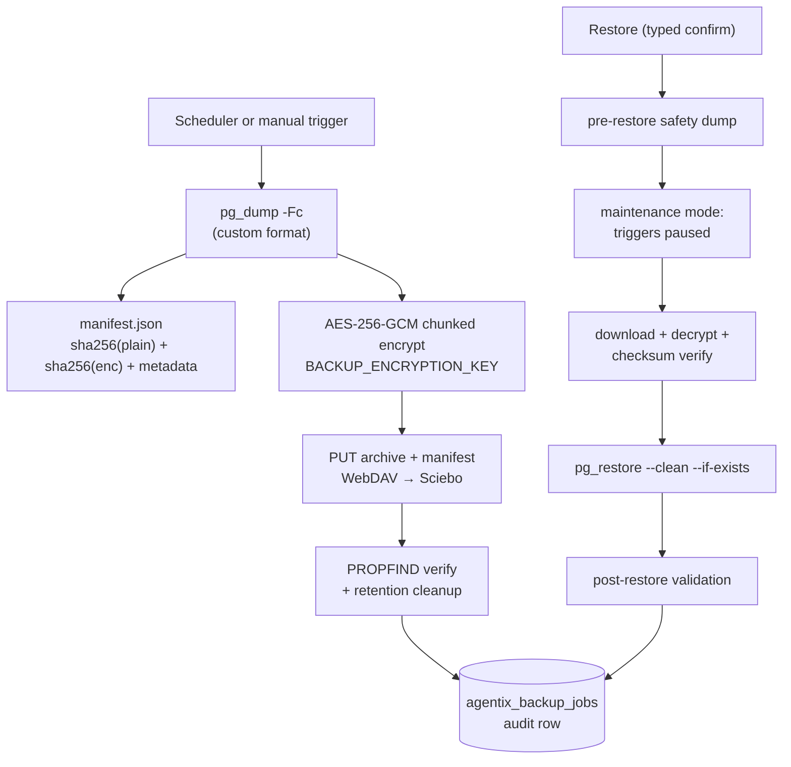

# Architecture

## System topology

## Components

| Layer | Path | Responsibility |
|---|---|---|
| API gateway | `app/main.py`, `app/routers/` | HTTP surface, auth, request size limits, static mounts (`/dashboard`, `/widget`, `/chat`) |
| Application config | `agent/config.py` | `AppConfig` (pydantic-settings): env vars → typed config; `connection_string` assembles the asyncpg DSN |
| Persistence | `app/*_store.py`, `agent/utils/pg_helpers.py` | Postgres-backed stores; tables created lazily via `ensure_tables()` |
| RAG core | `agent/` | Document processing, chunking, hybrid retrieval, assistants, tools |
| Agent runtime | `agent/tools/runner.py`, `agent/subagents.py`, `agent/observer.py` | Iteration loop, tool execution, dedup, subagents, observer, steering — see [Agent runtime](agent.md) |
| Agent workspace | `app/agent_workspace.py`, `app/doc_inspect.py` | Scoped persistent folders, quotas, document rendering/inspection |
| Code sandbox | `agent/tools/docker_sandbox.py`, `agent/tools/sandbox_server.py` | Per-run Docker containers for `code_execution`; `/agent_ws` mount |
| MCP | `app/mcp_client.py` | External MCP servers → `mcp__*` tool proxies |
| Schedulers | `app/triggers_scheduler.py`, `app/backup_scheduler.py` | Asyncio loops (30 s tick); DB-driven `next_run_at` due-checks |
| Dashboard | `dashboard/src/` | React SPA served from `/dashboard`; session-cookie auth |
| Widget | `widget/` | Standalone bundle served from `/widget` |

## Persistence model

Everything durable lives in one PostgreSQL database (default `agentix-db`):

| Domain | Tables (prefix `agentix_` unless noted) |
|---|---|
| Vectors | `langchain_pg_collection`, `langchain_pg_embedding` |
| Knowledge | `agentix_raw_files`, `agentix_source_state`, WebDAV source tables |
| Assistants | `agentix_instructions_versions` |
| Conversations | conversations / messages stores |
| Identity | dashboard users, API keys |
| Operations | runtime_config, metrics, tools, triggers, agent chains |
| Backup | `agentix_backup_config`, `agentix_backup_jobs` |

`data/` contains caches, downloaded models, **agent workspaces** (`agent_workspaces/` incl. the sibling `ws_render_cache` render cache) and temporary artefacts — it is **not** part of the backup scope and can be rebuilt. Agent workspaces are the exception to "rebuildable": they hold user-relevant files and survive until quotas or the orphan sweeper remove them.

## Startup lifecycle

The **BackupScheduler starts before RAG initialization**, so scheduled backups keep working even if LLM/embedding backends are unavailable.

## Backup data flow

See [Backup & Recovery](backup-and-recovery.md) for the full runbook.
