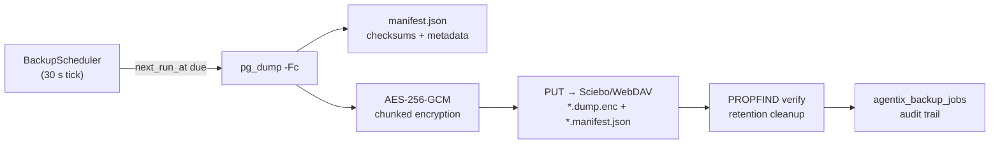

# Backup & Recovery

The platform keeps **all durable state in PostgreSQL** — assistant config, knowledge base (raw files + vectors), conversations, users, API keys, runtime config, triggers and WebDAV sources. A database dump is therefore a complete platform backup. The `data/` directory contains only rebuildable caches and models (plus agent workspaces, which hold user-relevant files) and is intentionally **not** backed up.

[[_TOC_]]

## How it works



- **Format:** `pg_dump -Fc` (PostgreSQL custom format, compressed) → `agentix-backup-<UTC-ts>[-<instance>].dump.enc`
- **Encryption:** chunked AES-256-GCM (`app/backup_crypto.py`) with `BACKUP_ENCRYPTION_KEY`. The archive leaves the host **only encrypted**.
- **Manifest:** sidecar `*.manifest.json` with `sha256_plain`, `sha256_enc`, sizes, timestamps, `pg_dump --version` — used for integrity verification without decrypting.
- **Storage:** WebDAV (Sciebo-tested). HTTPS only; remote path validated against `..` traversal.
- **Scheduling:** persisted `next_run_at` in `agentix_backup_config` — survives restarts; interval (minutes) or cron expression (with timezone).
- **Retention:** `retention_count` (keep newest N) and optional `retention_days`, applied only after a successful, verified upload.
- **Locking:** single-job `asyncio.Lock` prevents concurrent backup/restore runs.

## Setup checklist

1. **Encryption key** (mandatory — backups fail closed without it):

   ```bash
   # 64 hex chars or 32-byte base64
   openssl rand -hex 32        # → BACKUP_ENCRYPTION_KEY
   ```

   Add `BACKUP_ENCRYPTION_KEY=<key>` to `.env`. Keep it **outside the database and outside the WebDAV target** — losing it makes all archives unrecoverable.

2. **Database tools** — `pg_dump`/`pg_restore` must be on PATH (already in the Docker image via `postgresql-client`).

*Dark theme:*

3. **Dashboard** (Backups page, permission `backup:write`):
   - Enable automatic backups; choose interval (minutes) or cron + timezone.
   - WebDAV URL (HTTPS, e.g. `https://sciebo.de/remote.php/dav/files/<user>/`), remote path (default `/agentix-backups`), username, password. The password is stored Fernet-encrypted (`WEBDAV_ENCRYPTION_KEY`) and is never returned by the API (`password_set: true`).
   - Retention count/days.
   - **Test connection** performs a real write probe (MKCOL + PUT + PROPFIND + DELETE).

4. **Manual run:** "Run backup now" (or `POST /admin/backup/run`).

## Permissions

| Role | `backup:read` | `backup:write` | `backup:restore` |
|---|---|---|---|
| viewer / operator | — | — | — |
| editor | ✓ | — | — |
| admin / owner | ✓ | ✓ | ✓ |

## Restore

> [!caution]
> Restore is **destructive** — it replaces the current database. A verified safety dump of the pre-restore state is uploaded to `<remote_path>/pre-restore/` automatically.

The flow is protected end-to-end:

1. Dashboard → Remote archives → **Restore** opens a modal that requires **typing the full archive filename**.
2. Backend flow (`BackupService.restore_backup`):
   - set maintenance flag → triggers scheduler and backup scheduler pause
   - download archive + manifest, verify both SHA-256 checksums, decrypt
   - `pg_restore --list` sanity check of the dump
   - **pre-restore safety dump** of the current database (uploaded to `<remote_path>/pre-restore/`)
   - terminate foreign DB connections (`pg_terminate_backend` — needs the privilege on the DB role)
   - `pg_restore --clean --if-exists --no-owner --no-privileges`
   - post-restore validation (connectivity + schema)
   - clear maintenance flag; job row written to `agentix_backup_jobs` (`kind='restore'`)

> [!warning]
> **DB privilege requirement:** the database user must be allowed to run `pg_terminate_backend` on other sessions (e.g. `pg_signal_backend` role or superuser) and to drop/create objects for `--clean`. Verify this before relying on restores.

### CLI restore (alternative)

```bash
pg_restore --clean --if-exists --no-owner --no-privileges \
  -h "$PGHOST" -p "$PGPORT" -U "$PGUSER" -d "$PGDATABASE" backup.dump
```

(Requires decrypting the archive first — see below.)

### Decrypting an archive manually

```python
from app.backup_crypto import decrypt_file, load_encryption_key
decrypt_file("agentix-backup-....dump.enc", "backup.dump", load_encryption_key())
```

## Restore drill (acceptance evidence)

`tests/e2e/restore_drill.sh` runs an end-to-end drill against a scratch Postgres:

```bash
docker run -d --name agentix-pg -e POSTGRES_PASSWORD=test -p 55432:5432 postgres:16
export PGHOST=localhost PGPORT=55432 PGUSER=postgres PGPASSWORD=test PGDATABASE=postgres
export BACKUP_ENCRYPTION_KEY=$(openssl rand -hex 32)
./tests/e2e/restore_drill.sh
```

It seeds data → dumps → mutates → restores → asserts row counts and content. **A passing drill is the required acceptance proof** — a successful backup run alone is not sufficient.

## Failure modes

| Symptom | Likely cause |
|---|---|
| `503 … encryption key` | `BACKUP_ENCRYPTION_KEY` unset/invalid |
| `503 … pg_dump not found` | `postgresql-client` missing (custom image?) |
| `409 … already running / maintenance` | another backup or a restore in progress |
| `400 Invalid remote_path` | path not absolute or contains `..` |
| `400 Only HTTPS` | plain-HTTP WebDAV URL rejected |
| upload retries exhausted | Sciebo unreachable; check `backup_jobs.error` |
| restore fails at "terminate connections" | missing `pg_signal_backend`/superuser privilege |

Every run leaves an audit row (`agentix_backup_jobs`) with status, sizes, checksums, duration and error text.
