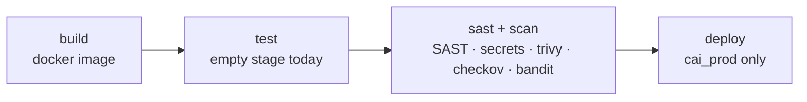

# Deployment

## Docker image

`Dockerfile` (`python:3.11-slim-bookworm`) installs:

- Runtime deps: `libmagic1`, `poppler-utils`, `tesseract-ocr` (+deu/eng), `ffmpeg`, `espeak-ng`, `postgresql-client` (for `pg_dump`/`pg_restore`), `curl`
- Python deps from `pyproject.toml` + `uv.lock` (via `uv export`); NLTK data pre-downloaded (disable with `--build-arg NLTK_DOWNLOAD=false`)
- Runs as non-root `appuser`; entrypoint `app/server.py` (granian, `API_SERVER=uvicorn` fallback)

```bash
docker build -t agentix .
```

## Compose

`docker-compose.example.yml` runs a single `agentix` service:

```bash
cp .env.example.complete .env
docker compose -f docker-compose.example.yml up -d
```

- Image: `agentix:latest`
- Volumes: `./data:/app/data` (caches/models/agent workspaces — not backup scope), `agentix-logs:/app/logs`
- `code_execution` needs Docker access — mount `/var/run/docker.sock` or set `DOCKER_HOST`; `SANDBOX_*` env vars tune the sandbox ([Configuration](configuration.md#code-execution-sandbox)).
- LibreOffice is bundled in the image — required for workspace `view`/`inspect` on Office docs and `document_generator` exports.
- `AGENT_WORKSPACE_ROOT`/`AGENT_WORKSPACE_APP_ROOT` handle the daemon-vs-app path split when the app itself runs containerized.
- Port: `8000:8000`; `restart: unless-stopped`
- **PostgreSQL is external** — set `PGHOST`/`PGPORT`/`PGDATABASE`/`PGUSER`/`PGPASSWORD` in `.env`.
- Health: `GET /health`.

## GitLab CI/CD (`.gitlab-ci.yml`)



- Build/deploy are restricted to branch `cai_prod`.
- Security jobs run on other branches.

## Production checklist

- [ ] `DASHBOARD_ENABLED=true` + `DASHBOARD_ADMIN_PASSWORD` + strong `DASHBOARD_SESSION_SECRET`
- [ ] `API_KEYS_ENABLED=true`, bootstrap `API_KEY` set
- [ ] `WEBDAV_ENCRYPTION_KEY` set (Fernet, for stored WebDAV passwords)
- [ ] `BACKUP_ENCRYPTION_KEY` set (AES-256-GCM, for backup archives) — stored outside the DB/backup target
- [ ] External Postgres reachable; DB role has `pg_terminate_backend` rights for restores
- [ ] Reverse proxy TLS termination in front of `API_PORT`
- [ ] Backup target configured & verified (Dashboard → Backups → Test connection); restore drill executed once
