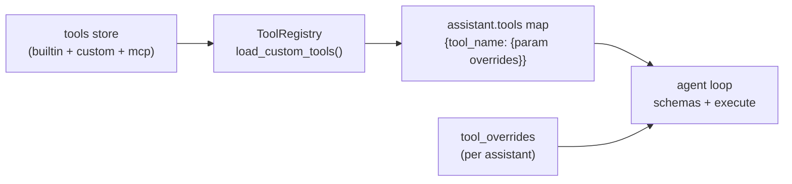

# Tools Reference

Every tool an assistant can call: built-ins shipped with the platform, per-tool configuration requirements, custom tools, and external MCP servers. Tools are enabled/disabled and assigned to assistants in the dashboard (**Tools** page and the assistant's Tools tab) or in `instructions.yaml` (`tools:` map).

[[_TOC_]]

## How tool assignment works

- Per-assistant entries in `tools:` can override default parameters (`tool_overrides` are applied at call time) — including the sandbox egress keys below.
- Builtin tools marked *config required* need their settings filled in the dashboard **Tools** page before they work. The page renders a structured form per tool from the backend's `config_schema` (see `app/tool_config_schemas.py`); secrets (passwords, API keys) are masked in API responses and replaced/cleared via the form.
- `webhook_post` additionally accepts `allowed_hosts` (fnmatch globs on the hostname, empty = any https host) and `allow_private_ips` (default `true`; `false` rejects literal private/link-local IPs — hostnames resolving to private IPs are not checked).
- All tool output is capped at 15,000 chars with a continuation footer; agent-internal tools are hidden from the chat UI.

## Knowledge & retrieval

| Tool | Purpose | Config |
|---|---|---|
| `rag_search` | Search knowledge collections (`search`/`list`/`read` actions; paged, line-numbered output) | RAG collections assigned to the assistant |
| `collection_manager` | Create/delete/list/read/edit collection entries — `edit` accepts a single `operation` or an ordered `edits` batch (insert/remove/replace, all-or-nothing) | same |
| `long_document_summarizer` | Extractive summary of text, URL or collection file (`max_sentences`, `focus`, `format`; `collection_file` reads raw files first, falls back to vector-store reassembly, `read_limit` 250k–1M) | — |

## Web & research

| Tool | Purpose | Config |
|---|---|---|
| `web_search` | Web search (DuckDuckGo-style, no key) | — |
| `web_scraper` | Fetch a URL → readable text (`fetch_with_js` for JS pages — see [Roadmap](roadmap.md)) | — |
| `serpapi_search` | Web search via SerpAPI | `api_key` in tool config or `SERPAPI_API_KEY` env |
| `openalex_search` | Scholarly graph (works, authors, venues) | — |
| `arxiv_search` | arXiv papers | — |
| `wikipedia_search` | Wikipedia articles — `search` for hits, `read` for full plain-text articles (paged, line-numbered) | — |
| `weather_lookup` | Current weather + short forecast | — |
| `rss_feed_reader` | RSS/Atom feed parsing | — |

## Files & execution

| Tool | Purpose | Config |
|---|---|---|
| `agent_workspace` | Persistent per-scope folder: `list/read/write/append/mkdir/delete/move/edit/offer/list_uploads/import_upload` + `view`/`inspect` document reading; `edit` takes an ordered `edits` batch (insert/remove/replace, all-or-nothing) | `workspace.*` on the assistant — see [Agent runtime](agent.md#agent-workspace); `AGENT_WORKSPACE_*` env vars |
| `code_execution` | Python in an isolated sandbox container — sees only `/tmp`, `/var/sandbox-packages`, optional `/workspace` and the `/agent_ws` workspace mount; no host fs, no docker.sock, no secrets. `packages` are pip-installed to the tmpfs package dir (`--prefer-binary`, import-cache refreshed automatically); unavailable when the egress policy disables internet. `action` adds persistent background jobs (tmux-style): `shell_start` launches a process that survives between calls (returns `job_id`), `jobs`/`output`/`write`/`wait`/`kill` manage it, `shell` runs a one-shot command — up to 20 jobs, ~4000-line scrollback per stream. `background: true` on `exec` makes the call **asynchronous**: it returns a `task-N` id immediately (the sandbox boot happens inside the task), up to 10 tasks can be registered per conversation — they share the sandbox's single exec lock so they run **one at a time** (queued tasks wait for the running exec; a foreground `exec` on a busy sandbox fails fast), and completion auto-injects a short `[code_execution task … finished]` nudge into the active run — the agent then collects the full output + attached files via `action='result'` (`wait`/`kill` accept `task-N` too; `jobs` lists tasks alongside shell jobs). Results persist in the conversation registry, so they stay retrievable even if the run ended first | `sandbox_mode` + egress policy `egress_internet` (default on) / `egress_local_network` (default off) / `egress_blocked` (CIDR list) in tool config — packet-enforced by a netns sidecar; Docker daemon access + `SANDBOX_*` env vars ([Configuration](configuration.md#code-execution-sandbox)) |
| `document_generator` | DOCX/PPTX/PDF artifacts with themes, charts, tables — incremental drafts via `create`→`add_*`→`finalize`, plus `edit` for ordered item ops (replace/insert/remove/move, all-or-nothing); `workspace_path` also drops a copy into the agent workspace; `deliver=false` keeps the file internal (no chat card, `action='publish'` attaches later); reusing a filename updates the existing card in place | LibreOffice in the image (`LIBREOFFICE_PATH`/`SOFFICE_PATH`) |
| `ssh_exec` | Shell commands on preconfigured remote hosts | host/credential settings in the Tools page |

## Communication

| Tool | Purpose | Config |
|---|---|---|
| `email_sender` | SMTP mail — text/HTML, CC/BCC, attachments (incl. `{artifact}` refs) | SMTP host/port/credentials in the Tools page |
| `email_reader` | IMAP inbox: `list` envelopes / `read` body by uid | IMAP host/credentials in the Tools page |
| `google_calendar` | Shared calendar via service account: `list/create/update/delete` | `service_account_json` + `calendar_id`; share the calendar with the SA |
| `webhook_post` | POST JSON to an HTTPS endpoint | — |

> [!warning]
> `email_sender`, `ssh_exec` and `webhook_post` act on real external systems — assign them only to trusted assistants and prefer scoped credentials.

## Agent internals

These orchestrate the run itself — usually keep them assigned (they are hidden from chat UI badges and excluded from subagent tools where noted):

| Tool | Purpose |
|---|---|
| `agent_memory` | Persistent per-conversation scratchpad |
| `agent_todo` | Run todo list (observer reads it; dashboard renders it). Statuses `pending`/`in_progress`/`completed`/`skipped` — open tasks block finalization (up to 3 reminders); leftovers are swept to `skipped` when the run ends |
| `spawn_subagent` | Launch background subagent tasks ([details](agent.md#subagents)) |
| `wait_subagent` | Collect subagent results (all or next-completed); returns early when new input is injected |
| `subagent_status` | Inspect live subagent activity |
| `nudge_subagent` | Inject a mid-run guidance message into a running subagent |
| `assistant_caller` | Invoke another assistant as a tool |
| `plan_generator` | Structured plan for a goal |
| `wait` | Bounded sleep for polling/retry; returns early when new input is injected |

## MCP servers (`mcp_servers`)

Not a callable tool itself — a **registry entry** listing external MCP servers whose remote tools become assignable `mcp__<server>__<tool>` proxies ([architecture](agent.md#mcp-integration)).

Per-server fields (dashboard → Tools → `mcp_servers` → `config.servers`):

| Field | Values |
|---|---|
| `name` | server label → tool prefix `mcp__<name>__*` |
| `transport` | `stdio` (subprocess: `command`/`args`/`env`) or `http` (streamable endpoint: `url`/`headers`) |
| `enabled` | include in the next sync |
| `tool_filter` / `deny` | glob lists over remote tool names |
| `call_timeout` | seconds per proxied call |

Discovery runs on a TTL resync and immediately after the entry changes; the persisted schemas keep proxies callable across restarts and outages.

## Custom tools

Dashboard-authored tools (`kind="code"`): Python code + own JSON schema, executed in a per-tool **venv** (`runtime_mode`) — create/edit via `/admin/tools*` (see [API](api.md#tools-custom--mcp)). Changes reload the registry in place, no restart needed.
